# GitJob — 시연 시나리오

> 시연 순서에 따른 화면별·실행별 상세 설명 문서다.
> 각 화면 이미지의 **파란 테두리**가 클릭 위치 또는 확인 지점을 표시한다.

## 시연 개요

| 항목 | 값 |
|---|---|
| 접속 주소 | `https://j15e102.p.ssafy.io` |
| 권장 브라우저 | Chrome 최신 버전, 전체화면(F11) 권장 |
| 권장 화면 비율 | 1920×1080 이상, 브라우저 배율 80~100% |
| 시연 계정 | 분석 결과가 준비된 GitHub 계정 권장 |
| 시연 소요 시간 | 약 7~10분 |
| 핵심 시연 | GitHub 근거 분석 → 채용공고 비교 → 학습 추천 → 기술 트렌드 |

### 시연 전 준비

1. GitHub 계정에 로그인해 두고 GitJob OAuth App의 접근을 허용한다.
2. 분석할 저장소 3개를 정한다. 발표 중 새 분석을 실행할 경우 크기가 작고 기본 브랜치가 정상인 저장소를 선택한다.
3. 저장소 분석은 clone·파일 파싱·규칙 평가를 수행하므로 완료까지 시간이 걸릴 수 있다. 발표 안정성을 위해 같은 계정에 **완료된 분석 결과를 미리 준비**한다.
4. 목표 직무는 **AI·데이터**, 지역과 경력은 **전체**로 저장해 둔다.
5. 시연 직전 채용공고와 기술 트렌드의 최신 수집 시각을 확인한다.
6. 비공개 저장소를 시연한다면 GitHub OAuth의 `repo` 권한과 내부 분석 worker 연결 상태를 사전에 확인한다.

### 전체 흐름

```text
① 랜딩 화면 → ② GitHub 로그인 → ③ GitHub 계정 선택·승인
   → ④ 저장소 선택 → ⑤ 분석 요청 → ⑥ 내 기술 대시보드
   → ⑦ 기술별 사용 근거 → ⑧ 목표 직무·채용 기술 수요
   → ⑨ 맞춤 공고 목록 → ⑩ 공고 요구사항 상세
   → ⑪ 다음 기술 추천 → ⑫ 기술 트렌드 → ⑬ 내 정보·분석 이력
```

---

## ① 랜딩 화면 · 로그인 진입

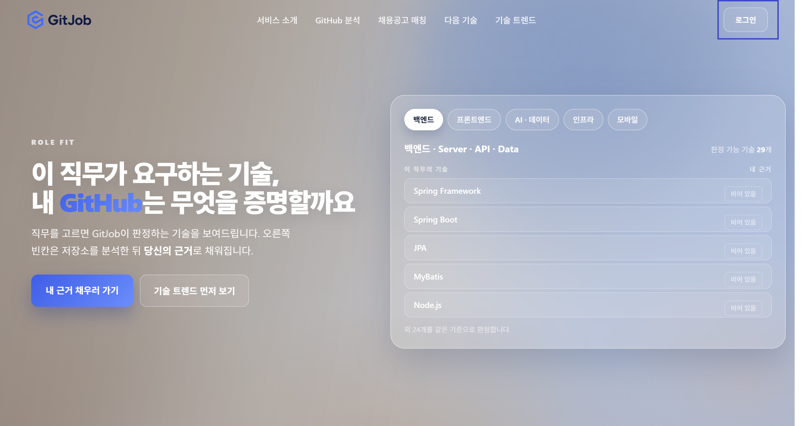

**화면 구성**

| 위치 | 요소 |
|---|---|
| 좌측 상단 | GitJob 로고 |
| 상단 중앙 | 서비스 소개 / GitHub 분석 / 채용공고 매칭 / 다음 기술 / 기술 트렌드 |
| 중앙 좌측 | 서비스 핵심 문구와 주요 진입 버튼 |
| 중앙 우측 | 직무별 기술과 사용 근거가 채워지는 모습을 표현한 미리보기 |
| **우측 상단(파란 박스)** | **[로그인] 버튼** |

**실행 순서**

1. 브라우저에서 `https://j15e102.p.ssafy.io`에 접속한다.
2. 랜딩 화면의 문구와 직무별 기술 미리보기를 짧게 소개한다.
3. 우측 상단 **[로그인]** 버튼을 클릭한다.

**설명 포인트**

- GitJob은 **GitHub 활동과 채용공고 데이터를 연결해 개발자의 기술 역량과 다음 학습 방향을 보여주는 커리어 플랫폼**이다.
- 사용자가 자기평가표를 작성하는 방식이 아니라 저장소에서 확인한 코드 근거를 바탕으로 기술 수준을 판정한다.
- 기술 분석, 공고 매칭, 다음 기술 추천, 시장 트렌드를 하나의 흐름으로 제공한다.

---

## ② GitHub 로그인

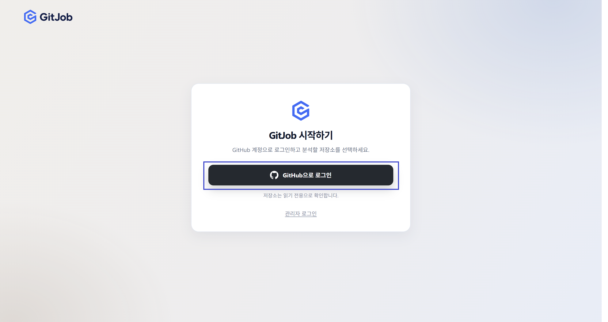

**화면 구성**

| 위치 | 요소 |
|---|---|
| 중앙 | GitJob 시작 안내 |
| **중앙(파란 박스)** | **[GitHub으로 로그인] 버튼** |
| 하단 | 저장소를 읽기 전용으로 확인한다는 안내 |

**실행 순서**

1. 중앙의 **[GitHub으로 로그인]** 버튼을 클릭한다.
2. GitHub OAuth 화면으로 이동하는지 확인한다.

**설명 포인트**

- 별도의 회원가입 양식을 작성하지 않고 GitHub OAuth로 로그인한다.
- GitHub에서 승인받은 권한으로 저장소 목록과 분석에 필요한 내용을 조회한다.
- GitHub 토큰은 Backend에서 암호화해 관리하며 브라우저 화면에 직접 노출하지 않는다.

---

## ③ GitHub 계정 선택 · OAuth 승인

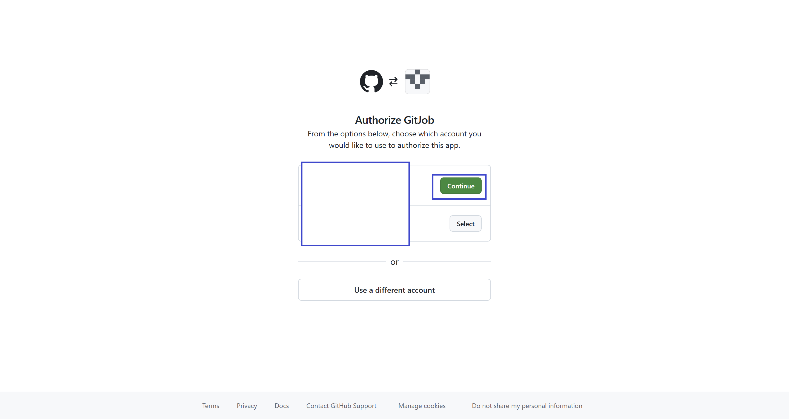

**실행 순서**

1. 사용할 GitHub 계정을 확인한다.
2. 기존에 연결한 계정이면 해당 계정의 **[Continue]** 를 클릭한다.
3. 다른 계정을 사용할 경우 **[Select]** 또는 **[Use a different account]** 를 선택한다.
4. 최초 연결 시 GitJob OAuth App의 권한 요청을 확인하고 승인한다.

**설명 포인트**

- GitHub에서 실제 인증을 처리하므로 GitJob이 GitHub 비밀번호를 받지 않는다.
- 공개 저장소와 사용자가 접근 권한을 허용한 비공개 저장소를 분석할 수 있다.
- 승인 후 GitJob callback으로 돌아오며 사용자 계정과 GitHub 계정이 연결된다.

---

## ④ 분석할 GitHub 저장소 선택

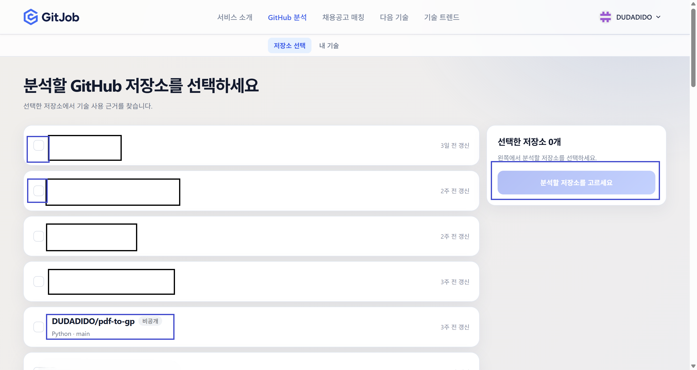

**화면 구성**

| 위치 | 요소 |
|---|---|
| 상단 보조 메뉴 | 저장소 선택 / 내 기술 |
| 좌측 | 로그인한 사용자가 접근할 수 있는 저장소 목록과 기본 언어·기본 브랜치·갱신 시각 |
| **각 저장소 좌측(파란 박스)** | **선택 체크박스** |
| 우측 | 선택된 저장소 목록 |
| **우측 하단(파란 박스)** | 선택 전 비활성화된 분석 시작 버튼 |

**실행 순서**

1. 저장소 목록이 정상적으로 불러와졌는지 확인한다.
2. 저장소 이름, 공개/비공개 여부, 기본 언어와 기본 브랜치를 설명한다.
3. 시연에 사용할 저장소의 좌측 체크박스를 순서대로 선택한다.

**설명 포인트**

- 사용자는 분석 대상을 직접 선택할 수 있으며 모든 저장소를 무조건 분석하지 않는다.
- 공개 저장소뿐 아니라 OAuth 권한이 있는 비공개 저장소도 선택할 수 있다.
- 분석은 저장소의 특정 시점 commit을 기준으로 고정해 재현 가능한 근거를 만든다.

---

## ⑤ 저장소 분석 시작

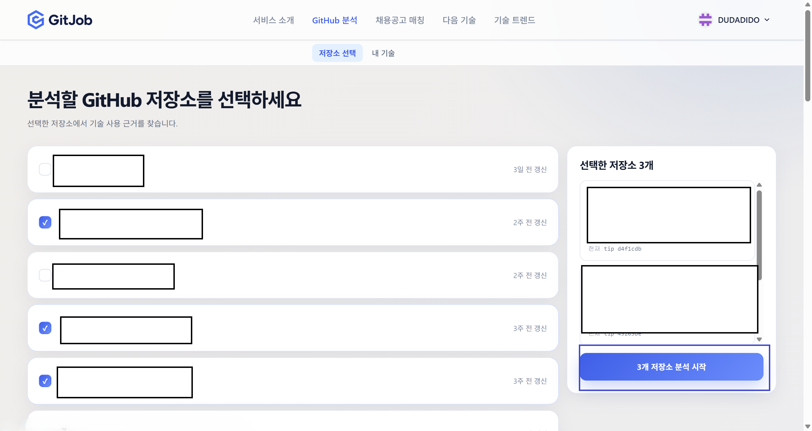

**화면 구성**

| 위치 | 요소 |
|---|---|
| 좌측 | 체크된 저장소 3개 |
| 우측 | 선택된 저장소 요약과 현재 tip commit |
| **우측 하단(파란 박스)** | **[3개 저장소 분석 시작] 버튼** |

**실행 순서**

1. 저장소 3개가 선택됐는지 확인한다.
2. 우측 선택 목록에서 저장소와 현재 tip commit을 확인한다.
3. **[3개 저장소 분석 시작]** 버튼을 클릭한다.
4. 분석 요청이 등록됐다는 안내를 확인한다.
5. 발표 중 즉시 완료되지 않으면 분석 과정만 설명하고, 미리 완료해 둔 결과로 이동한다.

**설명 포인트 ★**

- 분석 worker는 저장소를 clone한 뒤 dependency 선언, import, annotation, API 호출, 구성 파일과 운영 패턴을 함께 확인한다.
- 단순히 기술 이름이 등장했는지만 세지 않고 **실제로 어떤 코드에서 어떻게 사용했는지**를 근거로 남긴다.
- 규칙 엔진이 수준과 근거를 결정하고, LLM은 확정된 Fact Pack을 사람이 읽기 쉬운 문장으로 요약한다. LLM이 임의로 기술 수준을 정하지 않는다.
- 구조·내용 검증에 실패한 AI 설명은 낮은 temperature로 한 번 재생성하고, 다시 실패하면 규칙 기반 템플릿으로 안전하게 출력한다.

---

## ⑥ 내 기술 대시보드

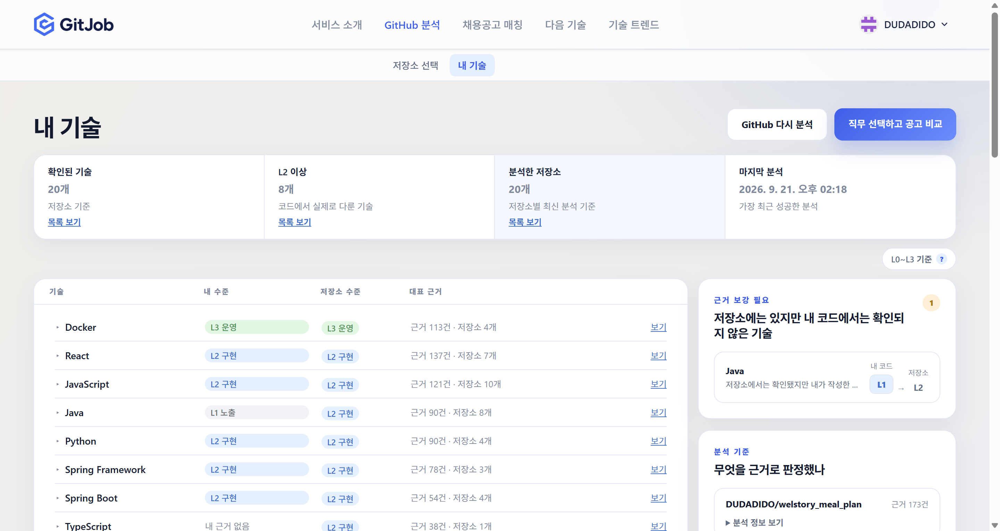

**화면 구성**

| 위치 | 요소 |
|---|---|
| 상단 요약 | 확인된 기술 수, L2 이상 기술 수, 분석한 저장소 수, 마지막 분석 시각 |
| 중앙 목록 | 기술별 내 수준 / 저장소 수준 / 대표 근거 / 상세 보기 |
| 우측 상단 | [GitHub 다시 분석], [직무 선택하고 공고 비교] |
| 우측 | 저장소에는 있지만 본인 코드에서 근거가 부족한 기술, 분석 기준 |
| 목록 상단 | L0~L3 기준 도움말 |

**실행 순서**

1. 상단 요약에서 확인된 기술과 L2 이상 기술 수를 보여준다.
2. Docker, React, JavaScript, Java, Python 등 기술별 수준을 비교한다.
3. Java처럼 **저장소 수준과 내 수준이 다른 항목**을 설명한다.
4. `L0~L3 기준 ?`에 마우스를 올려 수준 기준을 보여준다.
5. React 행의 우측 **[보기]** 를 클릭한다.

**레벨 설명**

| 수준 | 의미 | 대표 근거 |
|---|---|---|
| L0 | 의존성 확인 | 패키지/빌드 파일에 기술이 선언됨 |
| L1 | 노출·사용 시작 | import, annotation, 기본 구성 등 사용 흔적 확인 |
| L2 | 구현 | 주요 API 호출과 실제 기능 구현 확인 |
| L3 | 운영 | 배포·관측·장애 대응 등 운영 수준의 사용 확인 |

**설명 포인트 ★**

- **내 수준**은 사용자 기여 근거, **저장소 수준**은 프로젝트 전체 근거다.
- 팀 프로젝트에서 다른 팀원이 사용한 기술을 자신의 역량으로 과대평가하지 않도록 둘을 분리해 보여준다.
- 우측 `근거 보강 필요` 영역은 저장소에는 존재하지만 본인의 코드에서 충분히 확인되지 않은 기술을 알려준다.
- 각 판정에는 근거 수와 저장소 수가 함께 표시되어 결과를 추적할 수 있다.

---

## ⑦ 기술별 사용 근거 상세

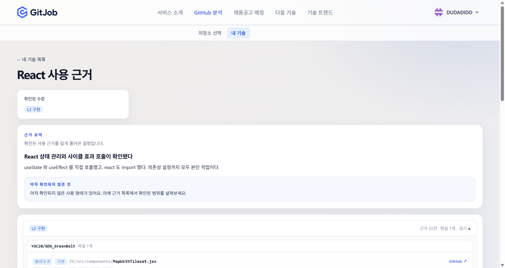

**화면 구성**

| 위치 | 요소 |
|---|---|
| 상단 | 기술명과 확인된 수준 |
| 근거 요약 | AI가 확정된 근거를 쉽게 풀어쓴 설명 |
| 안내 영역 | 아직 확인되지 않은 사용 형태 |
| 하단 | 수준별 저장소·파일·근거 목록과 GitHub 원문 링크 |

**실행 순서**

1. React의 확인된 수준이 `L2 구현`인지 확인한다.
2. 근거 요약에서 `useState`, `useEffect`, React import 등 실제 사용 내용을 읽는다.
3. 하단 근거 목록을 펼쳐 저장소명, 파일 경로와 근거 유형을 확인한다.
4. 필요하면 우측 **[GitHub ↗]** 링크로 실제 소스 위치를 연다.

**설명 포인트 ★**

- 결과를 점수만 보여주지 않고 **저장소·파일·코드 위치까지 연결**한다.
- AI 설명은 근거를 보기 쉽게 요약한 것이며, 최종 판정의 원천은 규칙 엔진이 찾은 코드 근거다.
- 확인되지 않은 항목도 함께 보여줘 분석 결과의 한계를 숨기지 않는다.

---

## ⑧ 목표 직무 선택 · 채용 기술 수요

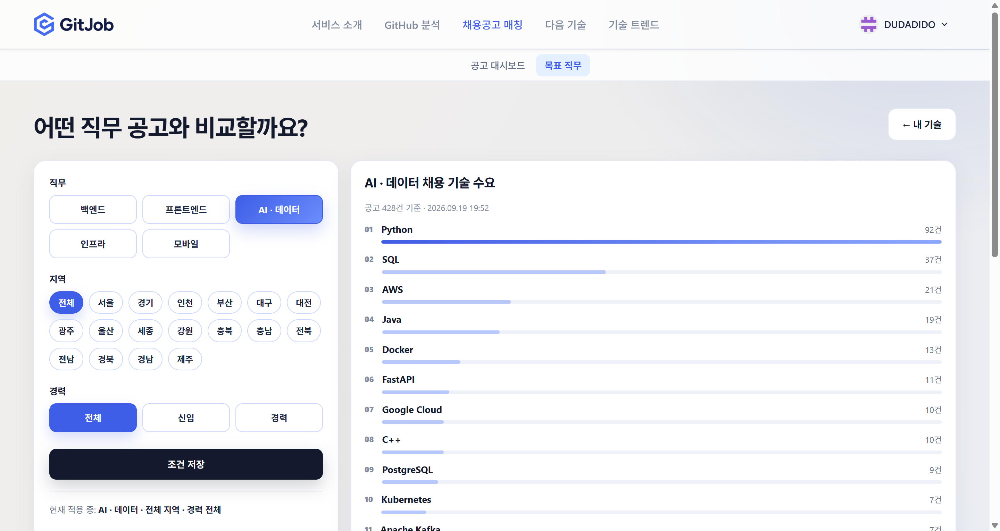

**화면 구성**

| 위치 | 요소 |
|---|---|
| 좌측 | 직무, 지역, 경력 필터와 [조건 저장] |
| 우측 | 선택한 직무 공고에서 자주 요구된 기술 순위와 공고 수 |
| 상단 보조 메뉴 | 공고 대시보드 / 목표 직무 |

**실행 순서**

1. 상단 **채용공고 매칭 → 목표 직무**로 이동한다.
2. 직무에서 **[AI·데이터]** 를 선택한다.
3. 지역 **전체**, 경력 **전체**를 선택한다.
4. **[조건 저장]** 을 클릭한다.
5. 우측의 Python, SQL, AWS, Java, Docker 등 채용 기술 수요를 확인한다.

**설명 포인트**

- 여러 채용 사이트에서 수집한 공고를 직무·지역·경력 기준으로 묶어 기술 수요를 계산한다.
- 화면의 기술별 숫자는 해당 조건의 공고에서 기술이 관측된 건수다.
- 이 시장 수요가 사용자의 GitHub 분석 결과와 결합되어 공고 매칭과 다음 기술 추천의 기준이 된다.

---

## ⑨ 내 기술과 맞는 공고

### 공고 대시보드 요약

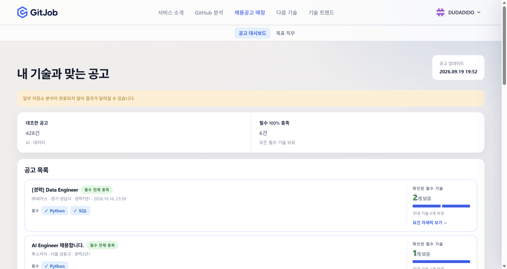

### 공고 목록 확인

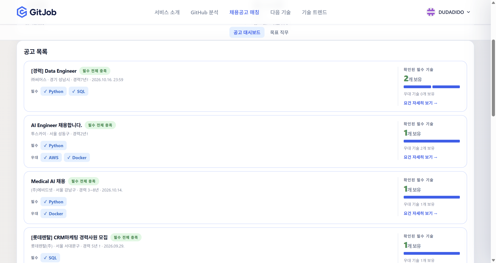

**화면 구성**

| 위치 | 요소 |
|---|---|
| 상단 | 공고 업데이트 시각과 분석 상태 안내 |
| 요약 카드 | 대조한 전체 공고 수, 필수 기술을 모두 충족한 공고 수 |
| 공고 목록 좌측 | 회사·지역·경력·마감일, 필수/우대 기술 |
| 공고 목록 우측 | 확인된 필수 기술 수와 충족 진행 바, [요건 자세히 보기] |

**실행 순서**

1. 상단 보조 메뉴에서 **[공고 대시보드]** 를 클릭한다.
2. 대조한 공고 수와 필수 기술 100% 충족 공고 수를 확인한다.
3. 목록에서 필수·우대 기술 태그를 확인한다.
4. 스크롤하며 여러 공고가 같은 기준으로 비교되는 것을 보여준다.
5. 공고 한 건의 **[요건 자세히 보기 →]** 를 클릭한다.

**설명 포인트 ★**

- 단순 키워드 추천이 아니라 **공고의 필수·우대 기술과 GitHub에서 확인된 기술을 직접 대조**한다.
- 사용자가 보유한 것으로 판정된 기술은 체크 표시와 충족 바에 반영된다.
- 일부 저장소 분석이 끝나지 않았으면 결과가 달라질 수 있다는 안내를 표시해 데이터 상태를 투명하게 보여준다.

---

## ⑩ 공고 요구사항 상세

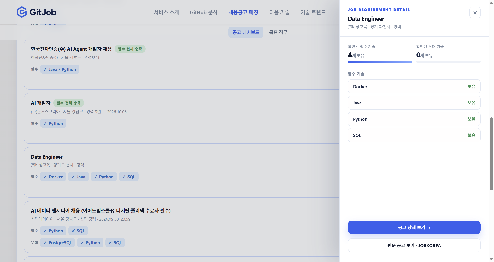

**화면 구성**

| 위치 | 요소 |
|---|---|
| 우측 패널 상단 | 공고명, 회사, 지역, 경력 |
| 중앙 | 확인된 필수·우대 기술 수와 기술별 보유 상태 |
| 하단 | [공고 상세 보기], [원문 공고 보기] |

**실행 순서**

1. 우측 상세 패널에서 공고의 기본 정보를 확인한다.
2. Docker, Java, Python, SQL 등 필수 기술이 `보유`로 판정된 것을 보여준다.
3. 확인된 필수 기술과 우대 기술의 개수를 비교한다.
4. 필요하면 **[원문 공고 보기]** 로 실제 채용 사이트 공고를 연다.
5. 우측 상단 `X`로 패널을 닫는다.

**설명 포인트**

- 공고의 요구 기술과 사용자의 판정 기술을 항목별로 확인할 수 있다.
- GitJob은 원문 공고를 대체하지 않고, 사용자가 최종 조건을 확인할 수 있도록 원문 링크를 제공한다.
- 공고별로 기술 요구사항이 다르기 때문에 같은 직무 안에서도 매칭 결과가 달라진다.

---

## ⑪ 다음에 배울 기술 추천

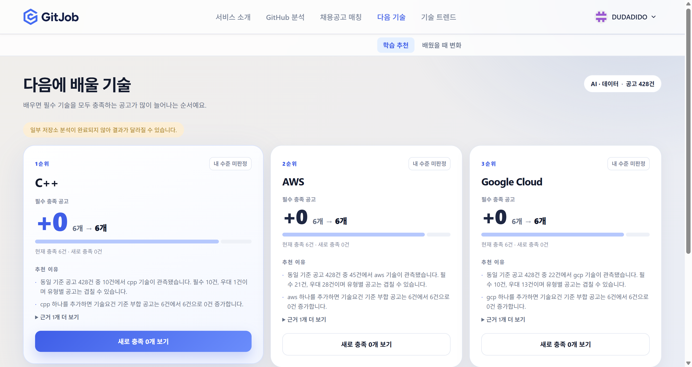

**화면 구성**

| 위치 | 요소 |
|---|---|
| 상단 | 학습 추천 / 배웠을 때 변화 |
| 우측 상단 | 기준 직무와 분석한 공고 수 |
| 기술 카드 | 추천 순위, 현재 판정 수준, 추가 충족 공고 수, 추천 이유와 근거 |

**실행 순서**

1. 상단 메뉴에서 **[다음 기술]** 로 이동한다.
2. 추천된 C++, AWS, Google Cloud 순서를 확인한다.
3. 각 카드에서 현재 충족 공고와 새로 충족할 공고 수를 확인한다.
4. **[근거 1개 더 보기]** 를 펼쳐 추천 근거를 보여준다.
5. 필요하면 **[배웠을 때 변화]** 탭으로 전환해 학습 후 매칭 변화를 비교한다.

**설명 포인트 ★**

- 추천은 유행 기술을 임의로 나열하는 것이 아니라 **선택한 직무의 실제 공고에서 얼마나 자주 요구되는지**를 기준으로 한다.
- 기술을 하나 더 보유한다고 가정했을 때 필수 조건을 새로 충족하는 공고 수를 계산한다.
- 화면 예시처럼 `+0`일 수도 있다. 이 경우 해당 기술의 시장 수요는 존재하지만 현재 공고의 다른 필수 조건 때문에 즉시 완전 매칭되는 공고가 늘어나지 않는다는 뜻이다.

---

## ⑫ 기술 트렌드

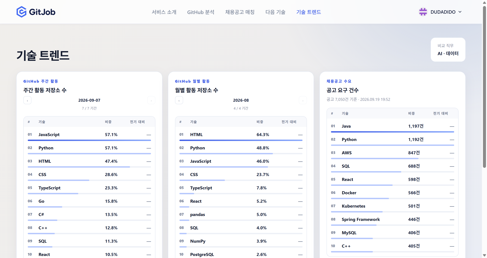

**화면 구성**

| 위치 | 요소 |
|---|---|
| 좌측 | GitHub 주간 활동 저장소 비중 |
| 중앙 | GitHub 월별 활동 저장소 비중 |
| 우측 | 채용공고 기술 요구 건수 |
| 우측 상단 | 비교 중인 목표 직무 |

**실행 순서**

1. 상단 메뉴에서 **[기술 트렌드]** 로 이동한다.
2. GitHub 주간 활동에서 JavaScript, Python, HTML 등의 순위를 확인한다.
3. GitHub 월별 활동에서 같은 기술의 장기 비중을 비교한다.
4. 우측 채용공고 수요에서 Java, Python, AWS, SQL 등의 요구 건수를 확인한다.
5. 개발 생태계의 활동량과 실제 채용 수요가 서로 다를 수 있음을 비교한다.

**설명 포인트 ★**

- GitHub 트렌드는 GH Archive 공개 이벤트에서 활동 저장소를 추출하고 저장소의 기술을 집계해 만든다.
- 주간은 최근 변화를, 월간은 비교적 안정적인 흐름을 보여준다.
- 채용공고 수요는 수집된 공고에서 정규화한 기술 요구 건수다.
- GitHub에서 많이 쓰이는 기술과 기업이 많이 요구하는 기술을 한 화면에서 비교할 수 있다.

---

## ⑬ 내 정보 · 분석 이력

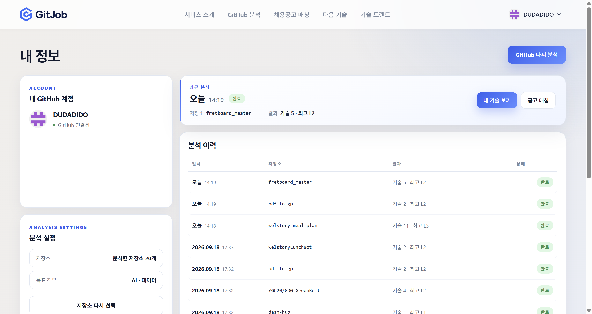

**화면 구성**

| 위치 | 요소 |
|---|---|
| 좌측 | 연결된 GitHub 계정과 분석 설정 |
| 중앙 상단 | 가장 최근 분석 결과와 빠른 이동 버튼 |
| 중앙 | 저장소별 분석 시각, 기술 수, 최고 수준, 처리 상태 |
| 우측 상단 | [GitHub 다시 분석] |

**실행 순서**

1. 우측 상단 프로필 메뉴에서 **내 정보**로 이동한다.
2. GitHub 계정이 연결된 상태인지 확인한다.
3. 최근 분석의 저장소, 완료 시각, 기술 수와 최고 수준을 확인한다.
4. 분석 이력에서 여러 저장소가 각각 `완료` 상태로 기록된 것을 보여준다.
5. **[내 기술 보기]**, **[공고 매칭]** 으로 결과 화면에 다시 이동할 수 있음을 설명한다.
6. 필요하면 **[GitHub 다시 분석]** 으로 저장소 선택 화면에 돌아간다.

**설명 포인트**

- 저장소별 분석 결과와 상태를 남겨 사용자가 어떤 분석이 결과에 반영됐는지 확인할 수 있다.
- 새로운 commit이 추가되면 저장소를 다시 분석해 기술 근거와 매칭 결과를 갱신할 수 있다.
- 한 번의 분석으로 끝나지 않고 개발 경험이 쌓이는 과정에 맞춰 계속 업데이트하는 서비스다.

---

## 시연 시 반드시 강조할 4가지

1. **판정 가능한 근거가 있는 기술 분석** — ⑥, ⑦
   - dependency 이름만 보는 것이 아니라 코드·구성·운영 근거를 단계별로 확인한다.
   - 저장소 전체 수준과 사용자의 기여 수준을 분리한다.
2. **설명 가능한 결과** — ⑦
   - 판정 결과를 파일과 GitHub 원문까지 추적할 수 있다.
   - LLM은 문장 요약을 담당하고 수준 판정은 규칙 엔진이 담당한다.
3. **실제 채용시장과 연결** — ⑧~⑪
   - 사용자의 기술을 실제 공고 요구사항과 비교하고 다음 학습 기술까지 연결한다.
4. **개발 생태계와 채용 수요의 동시 비교** — ⑫
   - GitHub 활동 트렌드와 채용공고 수요를 같은 기술 체계로 정규화해 보여준다.

## 시연 시 유의사항

- **새 분석은 즉시 끝나지 않을 수 있다.** 발표 전 완료된 결과를 준비하고, 새 분석은 요청 등록 과정까지만 보여주는 방식을 권장한다.
- 진행 중인 동일 저장소 분석이 있으면 새 작업 대신 기존 작업을 반환할 수 있다. 시연 전 `QUEUED` 또는 `ANALYZING` 상태가 장시간 남아 있지 않은지 확인한다.
- 비공개 저장소 분석은 OAuth 권한, 내부 broker, BE/worker의 공통 service token이 모두 정상이어야 한다.
- 일부 저장소 분석이 완료되지 않은 경우 공고 매칭과 추천 화면의 경고 문구가 표시될 수 있다.
- 채용공고와 트렌드는 수집 시점 기준 데이터다. 화면에 표시되는 업데이트 시각을 함께 설명한다.
- 외부 GitHub 또는 채용 사이트를 여는 단계는 네트워크 상태에 영향을 받으므로 발표 직전 확인한다.
- 계정명·저장소명·기업명 중 공개하면 안 되는 정보는 화면 공유 전에 가린다.

## 장애 발생 시 대체 진행

| 상황 | 대체 방법 |
|---|---|
| GitHub OAuth 지연 | 로그인 완료된 브라우저 프로필로 전환 |
| 저장소 목록 조회 실패 | 이미 분석이 완료된 계정의 `내 정보`에서 시작 |
| 분석 완료 지연 | 분석 요청 등록까지만 보여주고 `내 기술`의 기존 완료 결과로 이동 |
| 채용공고 원문 접속 실패 | GitJob 내부 상세 패널까지만 시연 |
| GPU LLM 요약 장애 | 규칙 기반 템플릿 결과로 서비스가 계속 제공됨을 설명 |
| 최신 트렌드 수집 지연 | 화면의 마지막 업데이트 시각을 밝히고 저장된 최신 결과로 진행 |

## 참고 이미지 목록

모든 이미지는 `exec/img/` 폴더에 있으며 파일 번호 순서가 시연 순서다.

| 파일 | 화면 | 단계 |
|---|---|---|
| `img/1.png` | 랜딩 화면 · 로그인 | ① |
| `img/2.png` | GitHub 로그인 | ② |
| `img/3.png` | GitHub 계정 선택·승인 | ③ |
| `img/4.png` | 분석할 저장소 선택 | ④ |
| `img/5.png` | 저장소 3개 분석 시작 | ⑤ |
| `img/8.png` | 내 기술 대시보드 | ⑥ |
| `img/9.png` | React 사용 근거 상세 | ⑦ |
| `img/11.png` | 목표 직무와 채용 기술 수요 | ⑧ |
| `img/12.png` | 맞춤 공고 대시보드 | ⑨ |
| `img/13.png` | 맞춤 공고 목록 | ⑨ |
| `img/14.png` | 공고 요구사항 상세 패널 | ⑩ |
| `img/15.png` | 다음에 배울 기술 | ⑪ |
| `img/16.png` | 기술 트렌드 | ⑫ |
| `img/17.png` | 내 정보와 분석 이력 | ⑬ |
